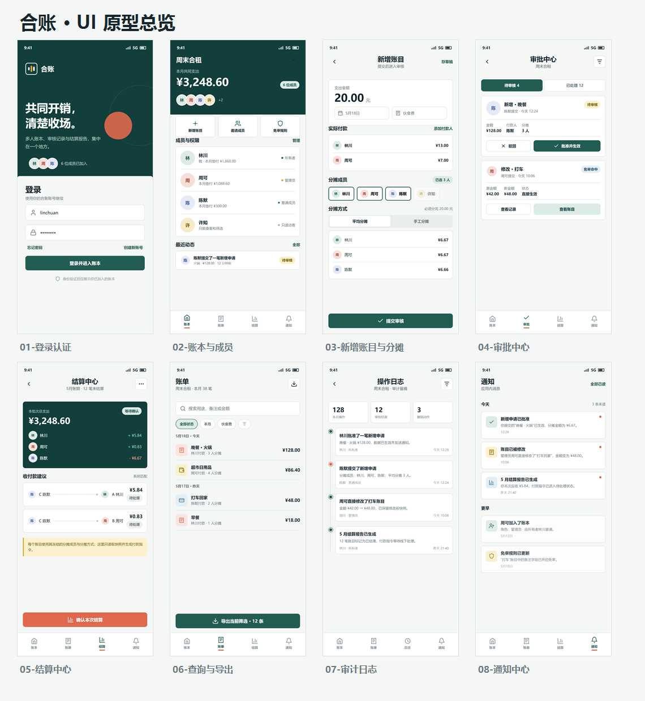
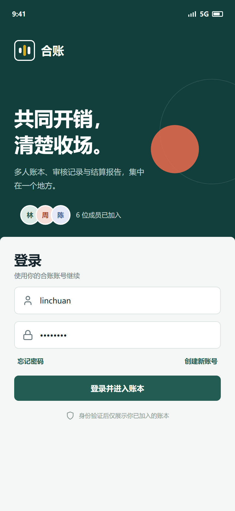
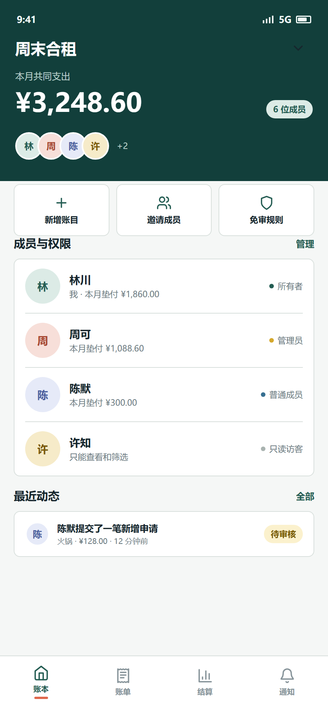
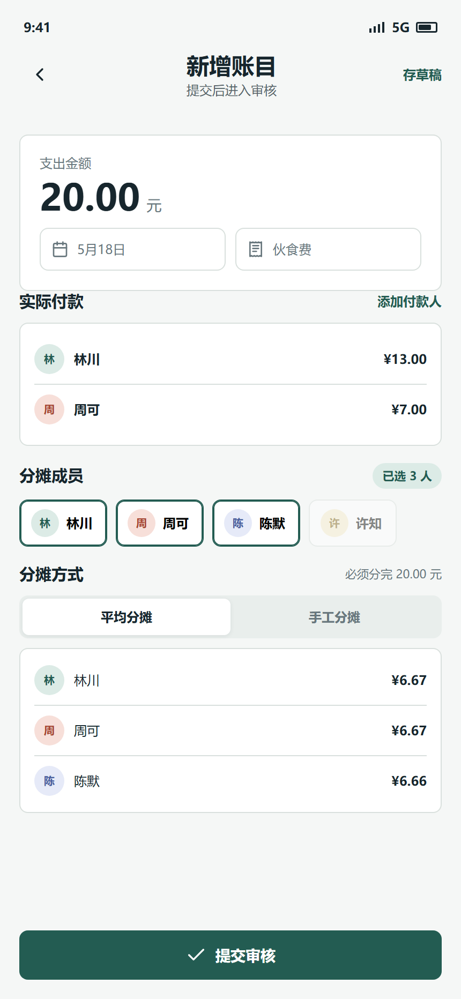
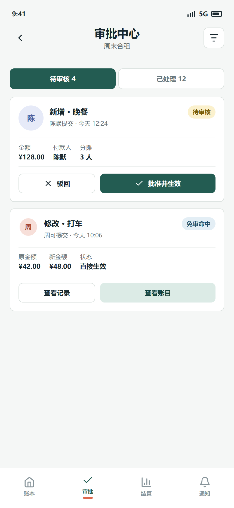
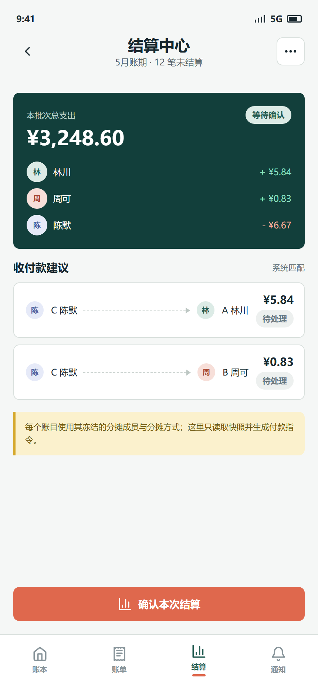
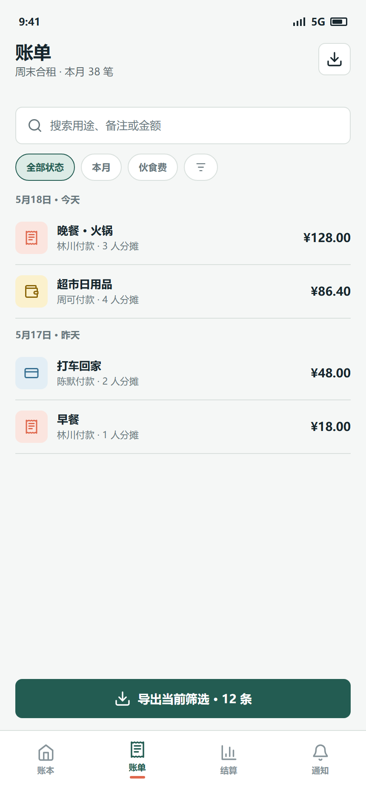
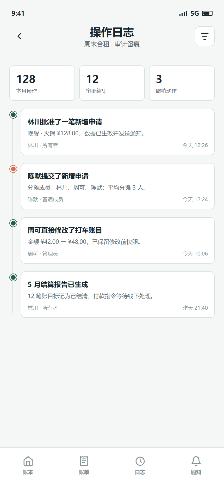
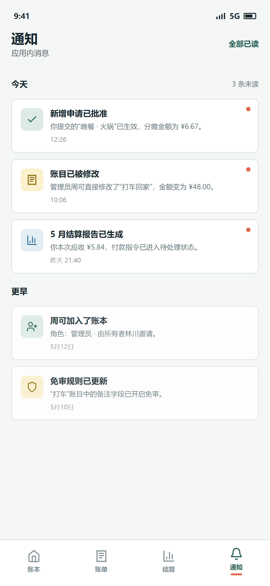

# 实验二 UI 界面设计说明

- 项目名称：在线多人记账系统
- 产品名称：合账
- 学号、姓名：241220168 黄国翔
- 目标终端：手机应用与微信小程序共用同一套信息架构
- 设计方式：可编辑 HTML/CSS 高保真原型，使用 Edge 无头模式导出 2 倍分辨率 PNG
- 原型源文件：`原型/index.html`、`原型/styles.css`



## 1. 视觉方向

界面采用“安静、清晰、便于核对”的移动端财务工具风格：

- 主色为深青色，表达账本的稳定与可信。
- 珊瑚色用于主要结算动作和警示状态。
- 金色用于待审核、免审和提醒状态。
- 蓝色用于普通成员、通知和辅助筛选。
- 背景为低饱和冷灰，卡片统一使用不超过 8px 的圆角。
- 金额使用等宽数字样式，便于纵向核对。
- 底部导航覆盖账本、账单、结算、通知四个高频入口。

## 2. 功能模块与界面

| 模块 | 界面文件 | 主要功能 |
| --- | --- | --- |
| 身份与认证 | `01-登录认证.png` | 用户名密码登录、注册入口、身份验证后限制账本可见范围 |
| 账本与成员 | `02-账本与成员.png` | 账本总览、成员角色、邀请成员、免审规则入口、最近动态 |
| 账目与审批 | `03-新增账目与分摊.png` | 多付款人、选择分摊成员、平均/手工分摊、份额预览、提交审核 |
| 账目与审批 | `04-审批中心.png` | 待审核/已处理筛选、批准、驳回、免审结果和修改记录入口 |
| 结算 | `05-结算中心.png` | 成员净额、系统匹配的收付款建议、付款状态、确认结算 |
| 查询与导出 | `06-查询与导出.png` | 用途搜索、日期/分类/状态筛选、账单列表、导出当前筛选结果 |
| 审计与通知 | `07-审计日志.png` | 操作统计、审批/修改/撤销/结算时间线、操作者与时间 |
| 审计与通知 | `08-通知中心.png` | 审批结果、账目修改、结算结果、未读状态和批量已读 |

## 3. 界面说明

### 3.1 登录认证



- 登录前不加载任何账本列表或账目数据。
- 登录成功后只展示当前用户已加入的账本。
- 注册、忘记密码和账号认证作为身份模块入口。
- 手机应用和微信小程序使用同一套用户身份。

### 3.2 账本与成员



- 顶部展示账本名称、当月共同支出和成员数量。
- 成员列表明确区分所有者、管理员、普通成员和只读访客。
- 邀请成员、免审规则作为所有者或管理员的高频操作。
- 最近动态帮助用户快速定位待审核事项。
- 当前用户在不同账本中的角色独立判断。

### 3.3 新增账目与分摊



- 支持一笔账目登记一名或多名实际付款人。
- 先选择至少一名分摊成员，再选择平均或手工分摊。
- 只读访客不可被选择为付款人或分摊成员。
- 平均分摊自动展示整数分结果，例如 20 元三人分摊为 `6.67 + 6.67 + 6.66`。
- 手工分摊模式下，每个已选成员都必须填写大于 0 的金额，且合计必须等于账目金额。
- 提交后进入待审核；命中免审规则时直接生效。

### 3.4 审批中心



- 待审核与已处理使用分段控件切换。
- 每条申请展示申请人、时间、金额、付款人、分摊人数和当前状态。
- 管理员可以批准或驳回，操作后写入审计日志并通知账目创建者。
- 免审命中的修改直接显示结果，并提供账目和修改记录入口。

### 3.5 结算中心



- 结算页不重新选择分摊成员，也不重新选择分摊策略。
- 成员净额由所有未结算账目中的实际付款和冻结分摊快照汇总得到。
- 正数表示应收，负数表示应付。
- 系统自动把债务人与债权人匹配成付款指令，例如陈默分别向林川、周可付款。
- 付款指令默认显示为待处理，系统不自动确认线下到账。
- 确认结算后保存报告、付款指令、账目结清状态和审计日志。

### 3.6 查询与导出



- 支持按用途、备注、金额搜索。
- 支持日期、分类、状态和垫付成员筛选。
- 列表按发生时间倒序展示，显示付款人与分摊人数。
- 导出范围是当前筛选结果，不包含汇总内容。
- 只读访客只能查看和筛选，导出按钮不向其展示。

### 3.7 审计日志



- 仅管理员和所有者可以查看本账本操作日志。
- 时间线展示申请人、操作者、操作结果、金额变化和时间。
- 审批、直接修改、撤销、结算等操作均留痕。
- 日志为追加式记录，界面不提供删除入口。

### 3.8 通知中心



- 展示审批结果、账目修改结果和结算报告生成等应用内通知。
- 未读通知使用红点标识，并支持全部已读。
- 通知按时间分组，保留历史通知。
- 手机应用与微信小程序共享同一份通知状态。

## 4. 关键交互状态

- 金额错误、分摊人数为 0、只读访客参与付款或分摊时，表单阻止提交并提示具体原因。
- 手工分摊合计不等于账目金额时，不允许提交。
- 服务端并发或版本冲突时，审批和结算页展示“数据已变化，请刷新后重试”。
- 结算付款指令存在 `OPEN`、`MARKED_PAID_EXTERNALLY`、`WRITTEN_OFF` 三种状态。
- 已结清账目不提供编辑、删除或撤销按钮。

## 5. 目录结构

```text
UI界面/
├── 01-登录认证.png
├── 02-账本与成员.png
├── 03-新增账目与分摊.png
├── 04-审批中心.png
├── 05-结算中心.png
├── 06-查询与导出.png
├── 07-审计日志.png
├── 08-通知中心.png
├── UI设计说明.md
└── 原型/
    ├── index.html
    └── styles.css
```

## 6. 说明

当前原型使用代码化设计画布完成，所有界面都可以在浏览器中打开源文件继续调整。后续如迁移到 Figma 或 Pixso，可以按照现有尺寸、颜色变量、组件和交互状态逐屏重建。PNG 已按 2 倍分辨率导出，适用于实验报告排版。
