# 软件工程

## 实验二：软件设计与建模


- 项目名称: 在线多人记账系统
- 学号: 241220168
- 姓名: 黄国翔
- 实验名称: 实验二：软件设计与建模
- 完成日期: 2026-11-11

## 一、软件主要功能与模块设计

功能行为以 lab1 为基线，本节只列出实验二在模块层新增的设计职责。

| 模块       | 实验二的设计职责                                                                                 |
| ---------- | ------------------------------------------------------------------------------------------------ |
| 身份与认证 | 建立用户身份上下文，为后续账本权限判断提供当前用户                                               |
| 账本与成员 | 使用稳定 `LedgerMembership` 表示成员身份，以 `MembershipPeriod` 表示加入、退出和重新加入的有效期 |
| 账目与审批 | 分别建模实际付款、账目、审批申请、修改记录和逐账目分摊方案                                       |
| 分摊       | 先选择至少一名分摊成员，再使用平均或手工策略；策略只接收 `SplitRequest`                          |
| 结算       | 只汇总已冻结的付款与分摊快照，按整数分生成成员净额和付款指令                                     |
| 查询与导出 | 在账本权限范围内筛选账目，导出当前结果                                                           |
| 审计与通知 | 记录业务操作、账目修改和付款状态变化，生成应用内通知                                             |

## 二、软件架构 UML 图

### 2.1 模块划分与交互

系统拆分为客户端层、API 网关、六类业务模块、统一数据访问层和数据库：

- 客户端层：Windows 桌面应用（当前实验交付）；后端接口保留移动端扩展能力。
- API 网关：认证上下文、路由和请求入口。
- 身份与认证：用户身份、认证方式和登录会话。
- 账本与成员：账本、稳定成员身份、成员有效期、角色和权限策略。
- 账目与审批：实际付款、账目状态、分摊方案、审批和修改记录。
- 结算：读取冻结的付款和分摊快照，计算净额并生成付款指令。
- 查询与导出：账单筛选、查询和导出。
- 审计与通知：操作留痕、应用内通知。
- 数据访问层：仓储、事务、索引和并发控制。

模块之间通过明确的应用服务接口交互，客户端不直接访问数据库。

### 2.2 类图

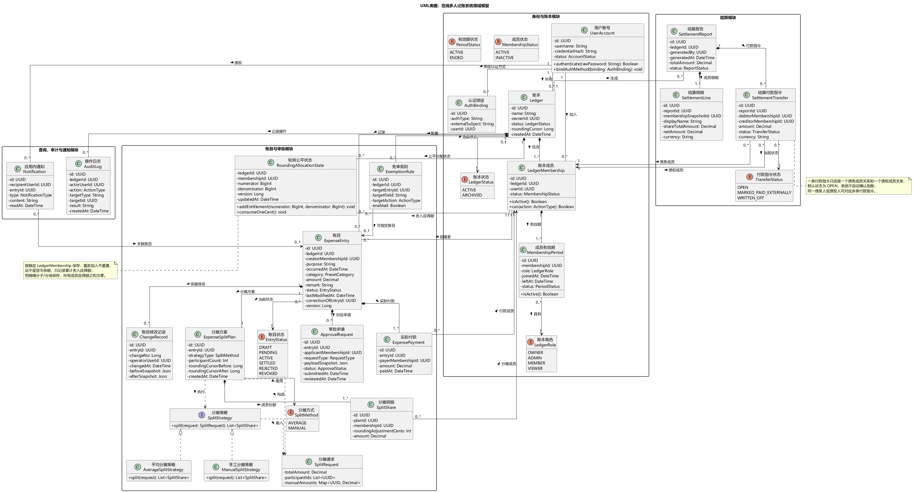

类图的核心设计如下：

- `UserAccount` 表示系统用户；`Ledger` 表示账本。
- `LedgerMembership` 是用户与账本之间的稳定成员身份。
- `MembershipPeriod` 记录加入、退出、重新加入的有效期和角色。重新加入不创建新的稳定成员，只新增有效期。
- `ExpenseEntry` 表示账目；`ExpensePayment` 支持一名或多名实际付款人。
- `ExpenseSplitPlan` 属于单笔账目，先固定分摊成员和策略。
- `SplitRequest` 携带总额、参与者集合和手工金额映射。
- `SplitStrategy` 只接收总额和参与者集合，不查询成员角色；平均策略和手工策略分别实现。
- `SplitShare` 保存每个成员关系的最终整数分份额。
- `SettlementReport`、`SettlementLine` 和 `SettlementTransfer` 保存结算快照、成员净额和付款指令。
- `RoundingAllocationState` 使用精确分数保存余数分的累计应得额，仅用于公平轮转，不是货币余额。
- `ChangeRecord` 追加保存账目修改前后快照，使用 `(entryId, changeNo)` 唯一定位。

### 2.3 组件图

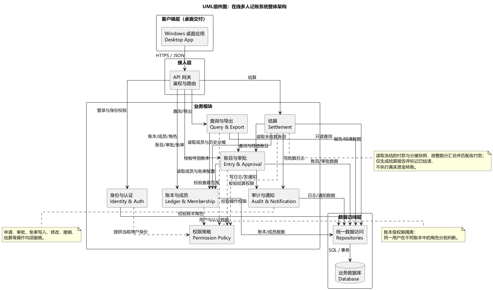

组件图说明：

- 桌面应用通过统一 API 网关访问后端业务规则，后续移动端可复用同一接口。
- 账本与成员模块是权限和成员资格的来源。
- 账目与审批模块依赖账本与成员模块进行角色、付款和分摊成员校验。
- 结算模块不重新执行分摊策略，只消费账目冻结的付款及分摊快照。
- 审计与通知模块集中处理日志和提醒，避免各模块重复实现。
- 数据访问层负责业务对象持久化、事务和索引。

如此设计的原因是：将身份、权限、账目和结算分开，避免账目模块承担所有职责；同时保证结算结果可以追溯、可重复生成，不受当前成员列表变化影响。

### 2.4 用例图

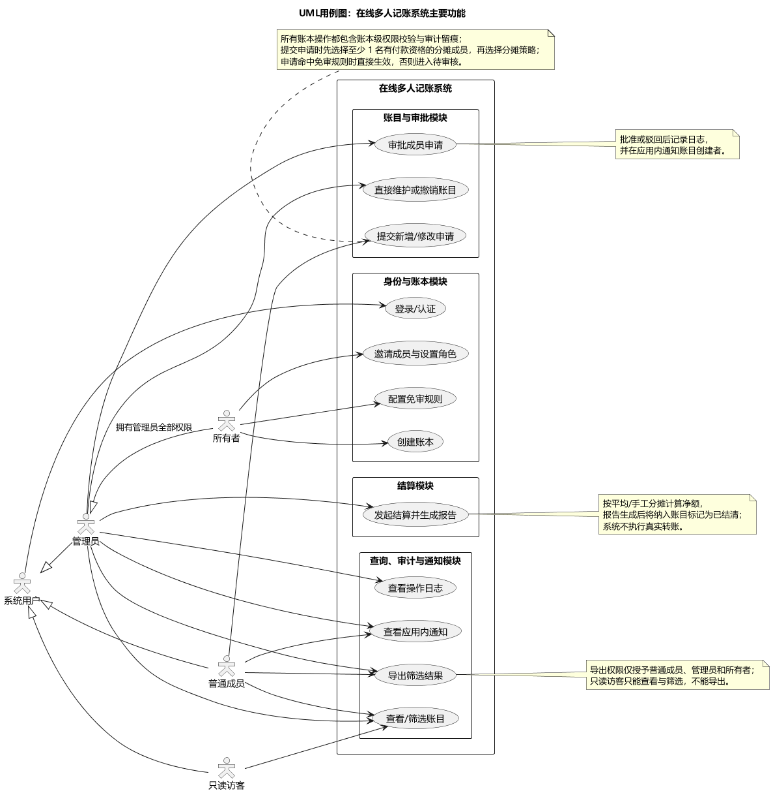

用例图只补充 lab1 未展开的设计边界：所有者继承管理员权限；只读访客不能参与付款、分摊和导出；审批、撤销、结算与日志形成明确的包含关系。

具体角色权限定义仍以 lab1 为准，本文不重复。

### 2.5 活动图

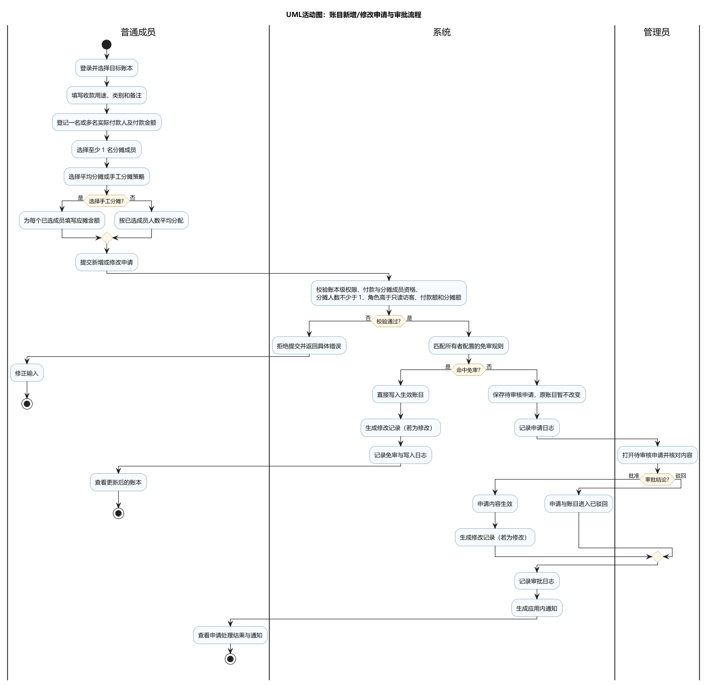

活动图描述账目申请和审批流程：

1. 用户登记用途、类别、日期和备注。
2. 登记一名或多名实际付款人及金额。
3. 选择至少一名分摊成员。
4. 选择平均分摊或手工分摊。
5. 手工分摊时，为每个已选成员填写金额。
6. 系统校验人数、角色、付款合计、分摊合计和金额规则。
7. 命中免审规则时直接生效；否则进入待审核。
8. 管理员批准或驳回，系统记录日志并通知创建者。

### 2.6 状态图

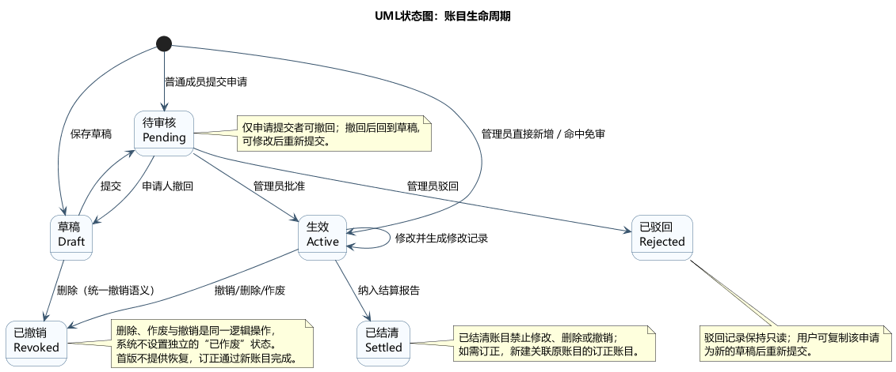

账目状态包括：草稿、待审核、生效、已结清、已驳回和已撤销。

- 草稿可以提交为待审核。
- 待审核可以批准为生效，或驳回为已驳回。
- 申请人可以撤回待审核账目，回到草稿。
- 生效账目可以修改，修改产生新的修改记录。
- 纳入结算后进入已结清，禁止继续修改、删除或撤销。
- 删除、作废和撤销统一使用撤销语义，不设置独立的“已作废”状态。

### 2.7 时序图

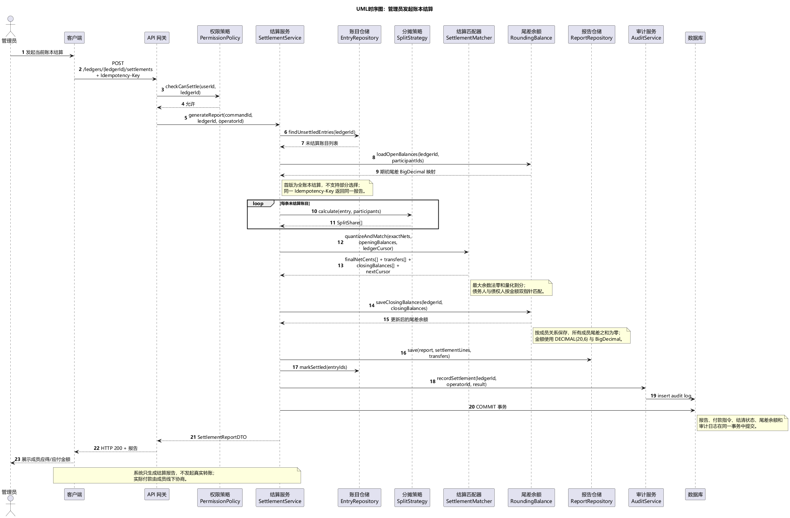

时序图描述管理员发起结算的流程：

1. 管理员提交结算请求，使用幂等键防止重复结算。
2. API 校验账本权限。
3. 结算服务读取全部未结算账目的付款快照和分摊明细。
4. `SettlementMatcher` 按稳定成员身份汇总整数分净额。
5. 正净额为债权，负净额为债务，生成债务成员到债权成员的付款指令。
6. 保存报告、付款指令、账目结清状态和审计日志。
7. 保存完成后返回结算报告。

结算阶段不重新选择分摊成员，也不重新执行分摊策略。分摊方案在账目提交时已经冻结。

### 2.8 关键设计理由

1. **按账目独立分摊**：不同账目可以使用不同分摊成员和不同策略，避免一个账本级分摊列表覆盖所有账目。
2. **先选成员，后选策略**：平均和手工分摊都只作用于已选成员；单人也可以合法分摊全部金额。
3. **整数分结算**：平均分摊除不尽时，将余数分按账本公平状态分配给具体成员，避免循环小数和无主尾差。
4. **稳定成员身份**：重新加入只新增 `MembershipPeriod`，不创建新成员，不重置公平状态；每笔账目已冻结的分摊方案自然实现历史隔离。
5. **结算与分摊分离**：结算只做跨账目汇总和债务匹配，降低修改账目对已完成结算的影响。
6. **全量审计**：账目修改、付款指令和结算批次都保留历史记录，便于追溯。

## 三、数据库关键设计

### 3.1 主要数据表

| 表                           | 作用                               |
| ---------------------------- | ---------------------------------- |
| `users`                      | 用户账号和认证信息                 |
| `ledgers`                    | 账本、所有者、账本状态和轮转游标   |
| `ledger_memberships`         | 稳定的账本成员身份                 |
| `membership_periods`         | 加入、退出、重新加入的有效期和角色 |
| `expense_entries`            | 账目总额、时间、状态和创建者       |
| `expense_payments`           | 实际付款成员及金额，可多条         |
| `expense_split_plans`        | 单笔账目的分摊成员、策略和游标快照 |
| `split_shares`               | 每个成员关系的最终整数分分摊额     |
| `settlement_reports`         | 结算报告批次                       |
| `settlement_lines`           | 每个成员的分摊合计和净额           |
| `settlement_transfers`       | 债务人到债权人的付款指令           |
| `rounding_allocation_states` | 公平轮转的精确分数应得额           |
| `change_records`             | 账目修改前后快照和修改序号         |
| `audit_logs`                 | 全操作审计日志                     |
| `notifications`              | 应用内通知                         |

### 3.2 关键约束和索引

- `ledger_memberships(ledger_id, user_id)` 唯一。
- 同一成员关系最多有一条有效 `membership_period`。
- `expense_split_plans.entry_id` 唯一，保证每笔账目只有一个当前方案。
- `split_shares(split_plan_id, membership_id)` 唯一。
- `change_records(entry_id, change_no)` 唯一。
- 查询修改记录按 `change_records(entry_id, change_no)` 复合索引执行。
- `settlement_transfers(report_id, debtor_membership_id, creditor_membership_id)` 建立查询索引。
- 所有金额变更、修改记录、付款指令和审计日志必须在同一事务中提交。

### 3.3 修改记录查询

账目修改记录采用追加写入，每次修改生成新的 `change_no`。查询某个账目的所有修改记录时，按复合索引读取：

```sql
SELECT *
FROM change_records
WHERE entry_id = @entryId
ORDER BY change_no;
```

记录较多时使用 `change_no` 游标分页，避免深分页扫描。

## 四、各个功能模块的 UI 界面及说明

本实验交付 Windows 桌面应用界面。UI 使用 1440 × 900 画布、可编辑 HTML/CSS 高保真原型和用户提供的 5 个 SVG 图标完成，并通过 Edge 无头模式导出 PNG。底部一级导航从左到右为首页、账本、结算、通知、个人中心；账目、审批和审计作为账本内部功能，不单独占用一级导航。

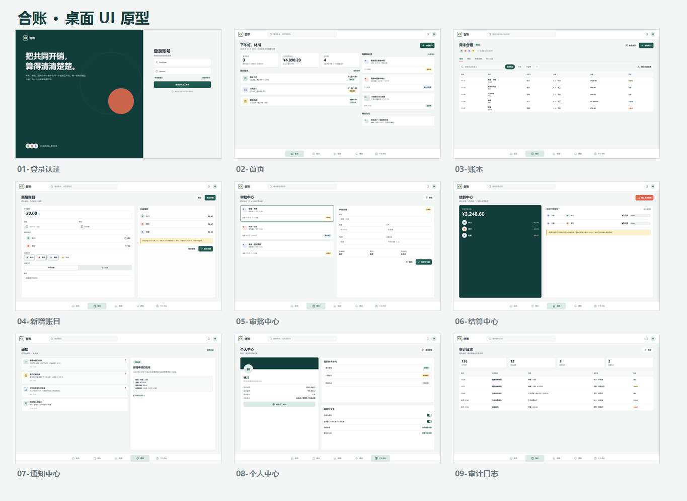

### 4.1 登录认证

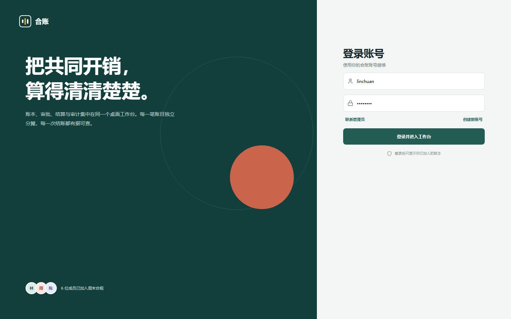

桌面登录页采用左右分栏布局。左侧展示产品视觉和当前账本成员，右侧提供用户名密码、注册和账号帮助入口。登录前不加载账本列表，登录后只显示当前用户有成员关系的账本。

### 4.2 首页

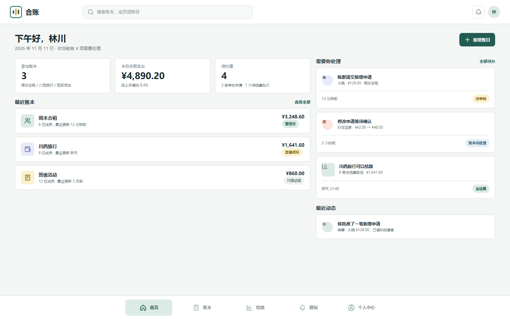

首页汇总参与账本数量、本月共同支出和待处理事项，并列出最近账本。待处理区域集中展示审批、修改和可结算批次。该页面提供跨账本概览，但实际账目仍从具体账本进入。

### 4.3 账本

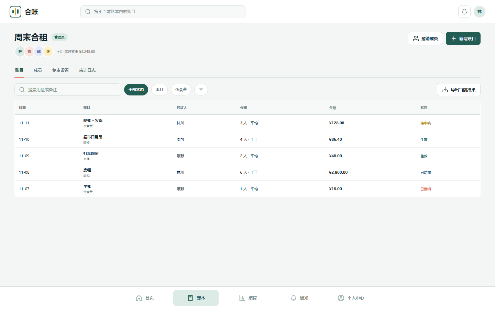

账本页是账目的唯一归属页面。顶部显示账本名称、角色、成员和本月支出，内部通过“账目、成员、免审设置、审计日志”切换。账目表格支持状态筛选、用途搜索和导出当前结果，避免再增加单独的“账单”一级入口。

### 4.4 新增账目

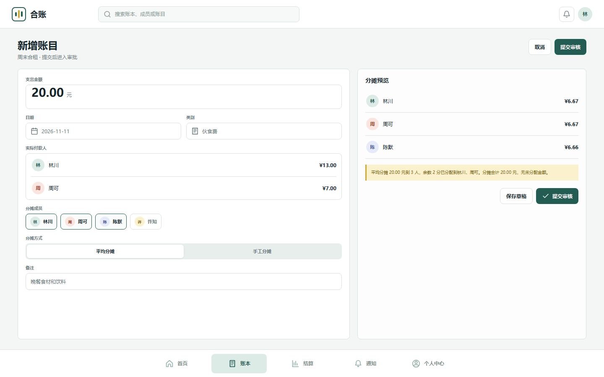

新增账目页支持一名或多名实际付款人，先选择至少一名分摊成员，再选择平均或手工策略。右侧实时展示个人份额和整数分分配说明。示例中 20 元由 3 人平均分摊为 `6.67 + 6.67 + 6.66`，余数分已分配到具体成员。

### 4.5 审批中心

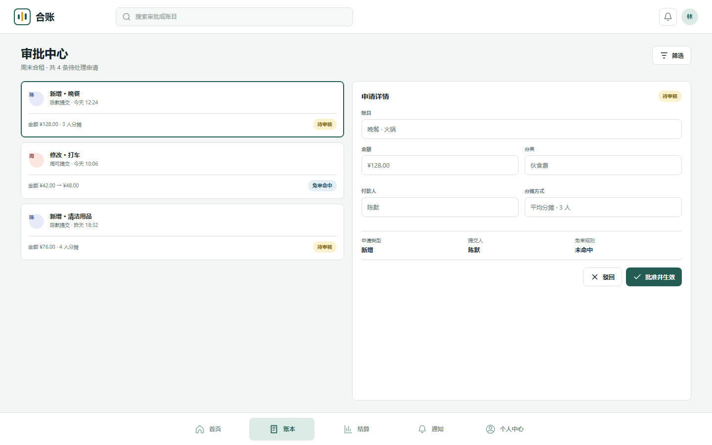

审批中心从账本上下文进入。左侧展示待审核列表，右侧展示申请详情、付款人、分摊方式和金额；管理员可以批准或驳回。处理结果写入审计日志，并生成应用内通知。

### 4.6 结算中心

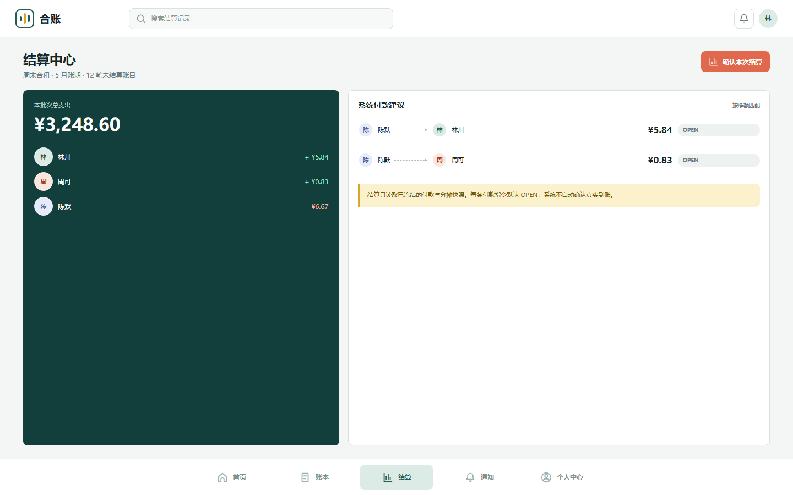

结算页展示每个成员关系的净额，以及系统匹配后的付款指令。页面不重新选择分摊成员和策略，所有金额都来自账目冻结快照。付款指令默认是 `OPEN`，系统不自动确认真实到账。

### 4.7 通知中心

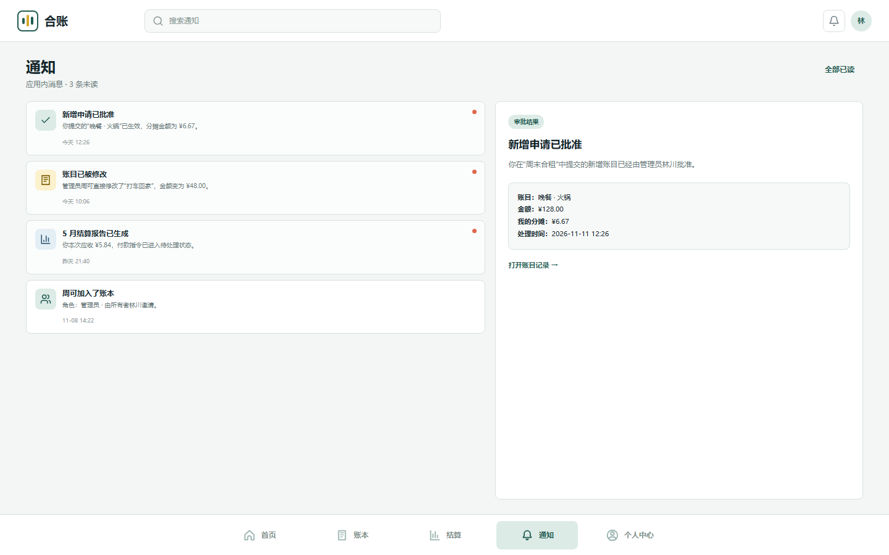

通知中心展示审批结果、账目修改和结算报告。未读状态使用红点标记，支持全部已读。点击通知可在右侧查看详情，并跳转到关联账目或结算记录。

### 4.8 个人中心

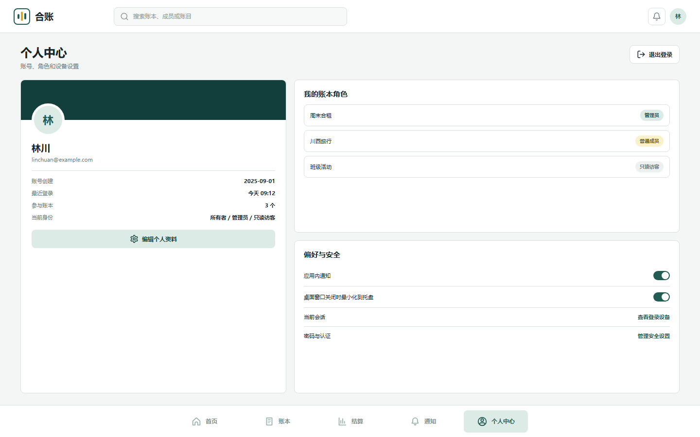

个人中心展示账号基本信息、最近登录、参与的账本和在不同账本中的角色。页面同时提供应用内通知、桌面托盘行为、登录设备和安全设置入口。

### 4.9 审计日志

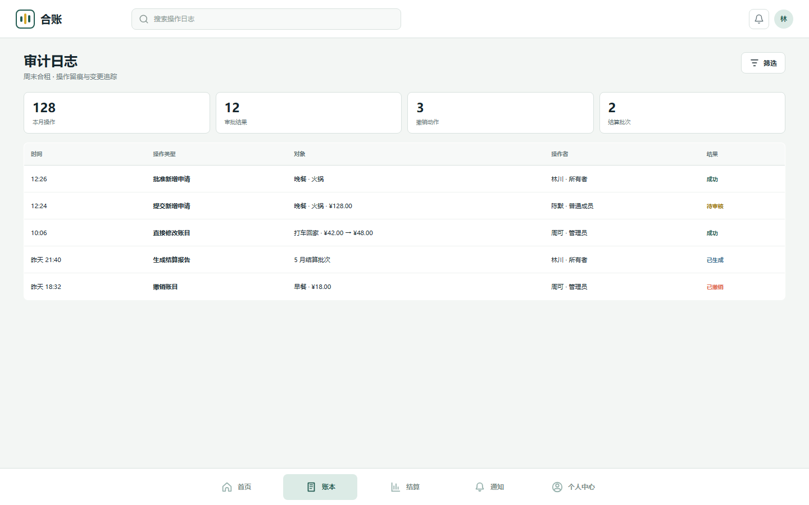

审计日志属于账本子页面。管理员和所有者可以查看审批、直接修改、撤销、结算等操作的时间、对象、操作者和结果。日志只追加，界面不提供删除入口。

## 五、AI 使用过程与反思

本项目在设计过程中使用大模型辅助梳理需求、生成初稿代码和检查设计漏洞。AI 仅作为辅助工具，最终结构和业务规则经过人工判断和修改。

| 使用场景   | 生成结果                                     | 发现的问题                                         | 修改后的结果                                                          |
| ---------- | -------------------------------------------- | -------------------------------------------------- | --------------------------------------------------------------------- |
| 需求整理   | 按模块整理账本、账目、结算和审计需求         | 初稿可能把模板性描述误当作已确认需求               | 回到 lab1 需求基线，只保留正式访谈和明确标注的待确认项                |
| UML 图初稿 | 生成类图、组件图、用例图和时序图初稿         | 初期版本把分摊策略绑定在结算周期上                 | 改为分摊方案属于账目，结算只读取冻结快照                              |
| 结算算法   | 提出 AA、尾差和债务匹配方案                  | 初版使用公共尾差池，出现无法判断归属的 `0.02` 元   | 改为整数分分摊、余数分落到具体成员、再匹配债务人和债权人              |
| 手工分摊   | 生成平均分摊和手工分摊接口                   | 原接口没有位置传入每个成员的手工金额               | 增加 `SplitRequest` 和手工金额映射，校验金额集合与合计                |
| 成员身份   | 处理退出和重新加入                           | 初版把重新加入当成新的成员关系，导致公平状态重置   | 改为稳定 `LedgerMembership` 加多条 `MembershipPeriod`，游标状态不重置 |
| UI 设计    | 生成 9 个桌面端功能界面 | 初稿存在导航结构、状态栏、文字间距、图标缺失和装饰元素比例问题 | 改为五个一级导航，统一 SVG 主题色并逐屏检查、修正和导出 |

### 5.1 大模型辅助的优点

- 可以快速生成 PlantUML 和界面代码初稿，减少重复排版工作。
- 能根据需求整理模块边界，帮助发现遗漏的角色和异常场景。
- 能对算法提供多个候选实现，便于比较不同方案的优缺点。
- 几个提示词就能做出完整的网页原型+高度成熟的UI界面，能极大减轻设计的负担。

### 5.2 大模型的局限

- 容易接受模糊规则并继续推演，产生看似完整但实际不平衡的方案。
- 生成的 UML 容易把领域实体、应用服务和结算步骤混在同一层。
- 对尾差、并发、历史成员等边界条件，需要人工从数据一致性角度重新检查。
- 生成GUI界面质量不稳定，需要人工审核。

### 5.3 总结

AI 适合承担初稿生成、文档结构整理和方案对照，但需求确认、金额规则、权限边界和数据库一致性必须由开发者自己把关。最终设计采用“账目独立分摊、整数分结算、稳定成员身份、精确公平状态”的方案，是在多次发现原算法问题后人工修正的结果。

## 六、总结

本设计围绕在线多人记账系统完成了主要功能划分、模块交互设计和面向对象建模，共提供 6 张 PlantUML 图：

- 类图：领域对象、分摊方案、付款、结算和修改记录。
- 组件图：客户端、API、业务模块和数据访问层。
- 用例图：不同账本角色的功能边界。
- 活动图：账目提交、免审和审批流程。
- 状态图：账目生命周期。
- 时序图：管理员发起结算的模块交互。

同时完成了 9 张桌面端功能界面，覆盖登录、首页、账本、新增账目、审批、结算、通知、个人中心和审计日志。底部一级导航固定为首页、账本、结算、通知和个人中心，账目及审批从账本内部进入。
